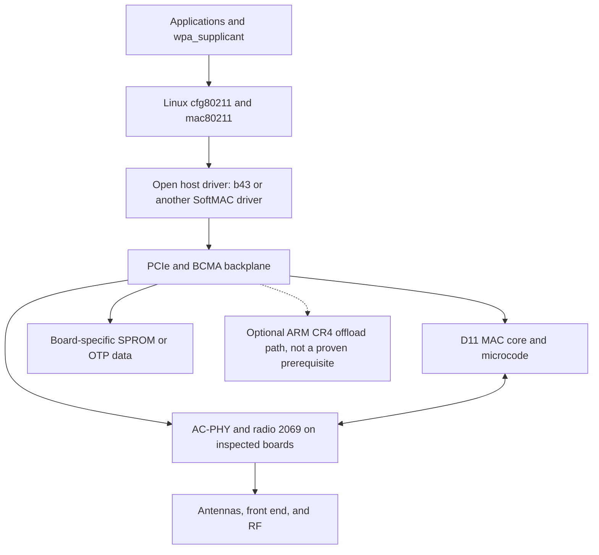

# BCM4360: a deep assessment of current open-driver reverse engineering

> Historical userspace research at frozen commits. Raw inputs and outputs are intentionally not bundled. Replace absolute path placeholders in recorded commands before use. This document does not imply hardware validation.

**Research snapshot: 2 October 2026.** Repository snapshots began at 14:52 UTC. This report examines source, recent history, development branches, retained experiments, independent issue reports, current upstream Linux, and safe host-side reproductions. It is not a new physical-radio validation.

**Scope:** your MacBook Air's BCM4360, the four projects we originally discussed, and three additional relevant efforts. No experimental kernel module was loaded, no card registers were accessed, and your NixOS configuration was not changed. Proprietary inputs used for host tests came from your already-present Nix source archive and remain outside your configuration repository.

## Executive answer

**Yes, this is now a credible engineering project, not a fantasy. No, there is not yet a dependable open driver to install on your Air.** The important distinction is between feasibility and readiness.

The strongest positive evidence is gonsolo's open b43-based prototype: real WPA2 association, DHCP and IP traffic on a MacBookAir6,1. That is a major milestone. Its latest recorded initialization campaign, however, judged only **9 of 43 attempts clean**, and its latest notes explicitly retract the earlier claim that 5 GHz reception works. HT/802.11n and VHT/802.11ac are missing end to end, not waiting behind one feature flag.

The strongest algorithmic and testing developments are aleferri's procedural b43 AC-PHY work and xZinio's specification-driven PHY/vendor-object comparison framework. I reproduced xZinio's **21 passing scenarios**, but also reproduced a substantial arithmetic gap that those scenarios miss: its RX IQ coefficient helper returns neutral coefficients for all nonzero measurements. The actual vendor helper does not.

**My recommendation is a collaborative b43/mac80211 effort, supported by better differential tests and explicitly decoded board data.** Do not start another whole driver from scratch, blindly concatenate these trees, or pursue brcmfmac merely because the chip has an ARM core. Use the projects as complementary evidence sources and extract narrowly reviewed, appropriately licensed contributions.

For you, the quickest first contribution is entirely host-side: fail-closed regression tests and fixes for false `IDENTICAL` verdicts, beginning with empty input, lost beacon template data and object-memory selector identity. The best bounded **numerical reverse-engineering** task is the nonzero RX-IQ coefficient routine. For combined hardware progress, prioritize width-complete, window-aware traces and trustworthy board-data provisioning. None requires experimenting on your only working writing laptop first.

## Contents

1. Evidence and frozen revisions
2. What has actually been missing upstream
3. Architecture: which processor does what?
4. Project-by-project findings
5. Tests reproduced, and what they prove
6. The genuinely hard remaining problems
7. Viability of competing approaches
8. A concrete research and acceptance plan
9. How LLMs help, and where they mislead
10. Safety, licensing and upstreaming
11. Corrections to our earlier discussion
12. Final recommendation and remaining uncertainties

---

## 1. Evidence and frozen revisions

I distinguish five levels throughout:

* **Reproduced:** commands ran here in userspace, with preserved logs.
* **Code verified:** inspected implementation at a frozen revision.
* **Author hardware evidence:** someone else's retained physical experiment or measurement. Not reproduced on your Air.
* **Author claim:** narrative or summary without enough publicly reproducible artifacts.
* **Assessment:** an inference or proposed plan, not a measured hardware result.

A passing emulator test is not physical RF proof. A registered wireless interface is not successful reception. A successful vendor `wl` connection is not an open-driver connection. A newer commit is not necessarily a newer working milestone.

| Project | Frozen default revision | Additional development evidence inspected |
|---|---|---|
| [gonsolo/bcm4360-acphy][g-tree] | `1493b8de401ddefef05916ce8b354f6d99d97797`, 1 Oct | Historical `wip-5ghz-tx`, `a920890b458d3fc79671b1047c7a687ea2cff777`, 27 Sep |
| [aleferri/b43-ac-wip][a-tree] | `a68a838d8793086ea980b6b71603a6a95623eebd`, 2 Oct | Current real-D11-core test work and independent hardware issue #4 |
| [aleferri/b43-add-bcm43xx-ac][a-old] | `fee3317cc7936dd2bfdf25e7f7ca6eae3601afb5`, 22 Sep | Redirect to the active project, not a separate competing implementation |
| [massimomazzariol/b43-bcm4360][m-tree] | `d8d8d7751773413beedab4b3105f319651d87ddc`, 27 Sep | Hardware-data ABI, passive RX implementation, loader tests |
| [0x00000109/OpenBRCM][o-main] | `06d60d610f4e1cba1f20a188453c8f3ba69357fb`, 25 Sep | Unmerged `m34d3b-band-init-test`, `22e77166f73c39dbf3d827c949403fda26e93bc8`, 28 Sep |
| [kimptoc/bcm4360-re][k-tree] | `7f822c789c7f3fda1aab001f79afb5df81642681`, 12 May | Unmerged healthy-card trace branch, `0ba568addc0c2d167938da8d5ddeb7cb9b91ac35`, 3 Jun |
| [xZinio/bcm4360][x-tree] | `eb271ace1c609a604202df7e3f8956856514a46f`, 30 Sep | Separate `open/` implementation, specifications, complete vendor-oracle test run |
| [aleferri/b43-tools][d11-tree] | `2361e9e8aad9f2912877b82be5cc529b3dd390a1`, 2 Oct | Separate public Python D11 instruction interpreter and co-simulator, inspected in follow-through |
| [Upstream Linux][linux-tree] | `ce1e0223d8ad4211275c82a17ed6d43ab81e13d9`, 1 Oct | Current b43, BCMA, brcmfmac and history, not an old support table alone |

The additional branches matter. OpenBRCM's draft PR description understates a branch with **179 changed files and about 59,759 added lines**, including crash postmortems. Kimptoc's default README does not describe June's externally supplied healthy-card traces. Gonsolo's September README is superseded by October notes.

This is a bounded public-evidence survey, not proof that no private, unindexed or unpublished work exists. Search results disproportionately surface installation guides and proprietary-driver patches. Those are not independent open AC-PHY implementations.

Detailed source locators and experiment logs are in [the evidence directory](evidence/SNAPSHOT.md). Each project's audit supplies more granular citations than this synthesis.

## 2. What has actually been missing upstream

### 2.1 Mainline has an AC-PHY placeholder, not a nearly finished driver

At the inspected upstream revision, `B43_PHY_AC` is still gated behind `BROKEN`, explicitly names BCM4352 and BCM4360, and warns that it crashes the driver. The AC implementation is roughly 88 lines: allocation, cleanup, low-level masked register access and default channel selection. It lacks operational initialization, channel programming and calibration. Its TX-power callback reports completion without implementing power adjustment. See [current Kconfig][linux-kconfig] and [AC-PHY source][linux-ac].

History places the substantive placeholder in Rafał Miłecki's January 2015 commit `3f7bb3f34cc8`, which prepared a place for AC support. Subsequent changes in that file are mostly maintenance, not the missing radio implementation.

That makes two things simultaneously true:

* Standard upstream b43 still does not support your chip as a working wireless device.
* The new out-of-tree projects have progressed far beyond the old mainline stub.

The mainline state is not evidence that current researchers have accomplished nothing.

### 2.2 SPROM revision recognition is not correct board-data extraction

Current BCMA recognizes a revision-11 SPROM image and validates the surrounding format, but its extraction path still calls the revision-8 decoder. That is visible in [current `drivers/bcma/sprom.c`][linux-sprom]. Accepting the revision byte is not decoding revision-11 chain masks, FEM topology, boardflags, PA coefficients and power limits correctly.

This is not an obscure cosmetic detail. Gonsolo's October revision-11 work changed apparently nonsensical antenna/chain values into a plausible **two-chain, FEM-control-2** board description. At the frozen revision, those newly decoded values are diagnostic information, not comprehensively consumed by its PHY implementation. See [note 112][g-112].

A shared chip ID does not give permission to copy one board's analog setup onto another.

### 2.3 BCM43602 is not BCM4360

Upstream brcmfmac supports various other Broadcom chips, including BCM43602. That name is not an alternate spelling of BCM4360. The inspected PCIe table does not provide working BCM4360 support. Likewise, brcmsmac's supported SoftMAC devices do not make it an existing AC driver. See [upstream brcmfmac PCIe source][linux-brcmf] and [official Broadcom driver documentation][brcm-doc].

Adding a PCI ID can make a driver bind to a device. It cannot supply a missing PHY implementation or a firmware service contract.

### 2.4 Upstream maintainers expect working functionality, not ID-table progress

The June 2026 b43 discussion is instructive. In response to early detection/bring-up patches, Michael Büsch asked for the device-ID patch to be submitted **last, after the driver is expected to actually work**. That is a practical upstream gate, not a rejection of the entire research effort. See [the initial series][b43-series] and [the maintainer's response][b43-response].

## 3. Architecture: which processor does what?

The most consequential architectural mistake is treating every chip with an ARM processor as a ready-made FullMAC device.

A useful model of this BCM4360 path is:



This is a proposed open-driver structure, not a claim that proprietary `wl` already uses mac80211. It does not: its closed host implementation contains its own substantial MAC/MLME code.

### Three different firmware/code components

| Component | Role | What extracting it does not solve |
|---|---|---|
| Closed host `wlc_hybrid.o_shipped` | MAC policy, PHY/radio procedures, DMA and hardware integration | Replacing it requires real host-driver functionality |
| D11 microcode and init tables | Time-sensitive MAC behavior and hardware initialization | Does not replace board configuration, calibration or host packet processing |
| ARM CR4 download image | Embedded runtime and offload functionality under the tested configuration | Does not automatically offer a complete brcmfmac-compatible WLAN service |

Kimptoc's firmware work is especially valuable here. It extracted an approximately **442,233-byte** `4352pci-bmac` ARM image from a Linux `wl.ko`, not from a macOS kernel module. The project achieved ARM release, console observation and partial shared-info behavior, but did not demonstrate a complete scan/control/event/data ABI. Its later analysis supports an offload-runtime interpretation of the tested path. Some code and strings suggest richer functionality, so the precise conclusion is **not demonstrated FullMAC**, not **mathematically impossible to run any MAC functionality on the ARM**. See [the transport investigation][k-transport] and [the detailed audit](evidence/kimptoc-audit.md).

The economical route is to let mac80211 provide appropriate management, rate-control and security machinery while implementing the silicon-specific host path. Writing an entire station stack duplicates solved work. Writing new FullMAC firmware adds a separate embedded-platform project.

Related firmware-patching research is useful for methodology, not a ready-made shortcut. [Nexmon's documented supported-device table](https://raw.githubusercontent.com/seemoo-lab/nexmon/master/README.md), checked on 2 October, does not list BCM4360. Its patches extend selected existing firmware, they do not supply the missing native host AC-PHY/D11 implementation for this Air. This is a scoped documentation check, not an audit of every Nexmon branch or proof that such a port is impossible.

## 4. Project-by-project findings

### 4.1 Gonsolo: closest to a working Air, but fragile and board-specific

**Target:** MacBookAir6,1, BCM4360 revision 3, D11 core revision 42, AC-PHY revision 1, radio 2069 revision 4. Those different revision numbers refer to different components and must not be collapsed into “revision 1.” The retained Air evidence identifies Apple subsystem `0117`; your exact Air model and board identity have not been established by this research session.

**Real accomplishment:** the b43-based implementation reports a WPA2 four-way handshake, DHCP and actual IP traffic. The notes describe concrete corrections to key handling, address-match state, autonomous ACK templates and stale replay commands. This is credible, technically specific physical progress, not just a modeled register match.

The October TX-status fix also matters. An attempt-count parser incorrectly included status bits from the wider word, making rate control see huge retry counts. Correcting it yielded reported **54 Mb/s legacy PHY transmission**, about **18.2 Mb/s upload** and **10.5 Mb/s download**. Those are author measurements, not reproduced here and not 802.11ac rates. See [note 110][g-110].

#### Latest limitations

1. **Initialization is unreliable.** Note 106 records 43 wrapper tries with 9 clean judgments, about 21%. The retry script is operationally useful but not a solution to the underlying defect. It checks connected state twice, 25 seconds apart, rather than continuously verifying traffic. A retained run was classified as failed and became connected later. Neither “connected” nor a wrapper exit code is a perfect physical-init oracle. See [note 106][g-106] and [the wrapper source][g-wrapper].
2. **Earlier kernel causality was overstated.** There were real version-correlated measurements, but later notes explicitly invalidate a one-init-per-boot bisect because good/bad initialization was bimodal. The latest proximate discriminator is managed-TX PHY errors and a busy microcode state. An 80 ms failed poll is not proof that an acknowledgment arrived 80 times more slowly. Kernel timing may still interact with the defect, but a specific causal regression is not established. See [notes 104][g-104] and [105][g-105].
3. **Five-GHz RX is not currently working.** The latest tests received zero frames at 5180 and 5580 MHz, while 2.4 GHz received frames. A partial 797-operation channel replay also failed. Earlier register readback was mistakenly treated as RF proof. See [note 111][g-111].
4. **HT and VHT are substantial missing paths.** Capabilities, PLCP/header/status formats, rates, bandwidth/NSS and aggregation have to agree end to end. See [note 113][g-113].
5. **The PHY still relies heavily on a vendor state snapshot.** A final-state replay can preserve one successful board state, but discards causal ordering, reads, dynamic inputs and phase transitions. The author notes major runtime calibration and power-control gaps. Some RCAL/RCCAL/VCO procedures do exist, so “there is no calibration code” would also be inaccurate.
6. **Reading registers is not inherently harmless.** The latest five-GHz debugfs PHY/radio walk hard-froze the machine. An indirect read changes selector registers and can touch inaccessible hardware domains. A “read-only investigation” is not automatically safe physical experimentation.

The older unmerged five-GHz TX branch contains useful experimental code, but no newer success overriding the October negative findings. The author also explicitly calls the prototype non-clean-room and not suitable for upstream incorporation as-is. Its [clean-room specification][g-spec] is useful research material, but needs version/provenance review and contains stale historical assumptions.

**Best use:** a real-air-traffic specimen and failure-analysis oracle for legacy 2.4 GHz. Not a drop-in daily-driver module, not an unreviewed source donor, and not proof of broad board support.

### 4.2 Aleferri: procedural b43 integration and multi-board tracing

**Target and method:** active b43 AC-PHY development, initially centered on BCM4352 router hardware with radio 2069 and FEM-control-6. The project also collects BCM4360 and Apple-board captures. The earlier `b43-add-bcm43xx-ac` repository redirects here. The inspected October 2 commit strengthens host tests by using real D11 core code, rather than only PHY-side stand-ins.

Its important contribution is moving from static snapshots toward actual procedures: reset/init, radio tuning, gain tables, calibration-related work, board-specific conditionals, D11/BCMA integration and trace-backed regression tests. This is the appropriate direction for a reusable driver.

**The reported near-99.9% matching is not 99.9% driver completion.** It scores particular traced operations on reference captures. It does not establish successful over-the-air transmission, every hidden bus store, every board, or all runtime calibration inputs. Transfer scores to other captures are lower, illustrating the board/generalization problem. See [README][a-readme], [provenance][a-provenance] and [the detailed audit](evidence/aleferri-audit.md).

An unusually important independent [hardware report, issue #4][a-issue4], describes three concrete integration failures: an RF gain table programmed as 8-bit instead of 48-bit entries, a wait testing the wrong RF-sequencer trigger bit, and TX-power adjustment without the required MAC-suspended context. The reporter explains how raw stores bypassed the accessor-level tracing, so excellent accessor matching missed a destructive width error. After local corrections and a matching microcode choice, the report still described no observed beacon and PHY TX errors.

At this exact HEAD, I reproduced the D6220 cold ch36/20 result of **29,817/29,849 = 99.89%**, plus both 43-segment cold-sweep ranges. The sweep's overall positional gates still exited 1 at divergence sites, despite near-perfect aggregate percentages. A BCM4360 agcombo capture scored **91.15%** in this run. The periodic 496-operation comparison matched. An instrumented cold run under UBSan produced the same trace without a diagnostic. Full integration was attempted but blocked before compilation by missing kernel headers, so its reported 82.61%/67.53% scores are not independently reproduced here.

The current source confirms two of the independent reporter's defects still exist: the gain table is written using an 8-bit path despite its 48-bit definition, and the RF-sequencer wait tests bit 0 while commands can trigger other bits. The TX-power callback now does bracket adjustment with MAC suspend/enable. That does not mean the reporter's locally fixed hardware result is an acceptance test of this October HEAD. Production channel switching also still rejects 2.4 GHz, while the unit harness enables it with a test-only override. See [gain-table source][a-gain], [RF-sequencer source][a-rfseq] and [channel gate][a-24].

The new D11 test layer deserves particular care. The compiled C model stores decoded writes and synthesizes a boot handshake. It does **not** execute real microcode or model the RF layer. A separate external interpreter/prologue path exists. It was not present in the initial driver-tree audit, but the public tool was subsequently cloned, pinned and tested as described below. I reproduced false `IDENTICAL` verdicts for empty input, differing beacon template words, and a host-state difference hidden by microcode-overlay filtering. Object-memory selectors can alias in normalization, and the wrapper associates the two microcode overlays with opposite sides. These are concrete host-side counterexamples, not allegations that every trace score is false. They show which missing assertions are needed before scores can support stronger conclusions. See [D11 test scope][a-d11] and the synthetic fixtures in the detailed audit.

Board progress is real: the current tree contains a MacBookAir6,1 profile, FEM2/sub1 table and two-wired-chain configuration. But unknown frontend handling only returns from a void helper and does not abort the enclosing initialization. Some calibration failure checks are not propagated. The router-observed PMU mask also differs from the captured Air vendor mask. Those are source-confirmed transfer risks, not proven causes of the Air's failure.

Licensing is **mixed at file level**: root `LICENSE` is GPLv3, key inherited files are `GPL-2.0-or-later`, some support files say GPL-2.0, and new D11 files lack SPDX notices. A blanket claim that every line is GPLv3-incompatible would be wrong. The project's provenance also records pending permission for MacBook traces and an unreproducible AGSOT source-table reference. Clarify contributions individually before importing them or distributing a combined corpus.

**Best use:** likely the most valuable b43-integrated procedural foundation, conditional on reviewing specific current functions, hardware validation and GPL-2.0-compatible provenance. Do not claim that its current branch is a working Air driver merely because its test captures include an Air.

#### Follow-through: the separate D11 interpreter really executes instructions

I checked the public [aleferri/b43-tools interpreter][d11-psm] rather than leaving its external dependency as an unexamined gap. It is available and has GPLv2 notices. It decodes and executes actual D11 instruction words against a partial model. That is materially stronger than the driver's C replay model's synthetic boot bit.

Using the already-local vendor firmware, I reproduced revision/patch writes **0x0340/0x007f** from the appropriate version-block entry and independently matched them to the original ELF's BOM symbols. This is narrow instruction-execution evidence, not a hardcoded stamp. The two important qualifications are:

* **Firmware identity and endianness matter.** Our x86 ELF stores little-endian words, while the interpreter expects raw big-endian 32-bit words. Normalizing that encoding was necessary. This firmware has 5,425 instructions and its relevant stamp entry is `0xe46`, not the tool's default `0xf76`. Copying the router extractor's assumptions onto a laptop object does not produce a trustworthy result.
* **Actual execution still has model limits.** From reset, the strict probe stopped in a hardware-wait heuristic without producing the stamp. The successful partial-entry run used best-effort instruction semantics beyond the initial writes. Condition flags, IHR/MMIO, DMA, timing and packet handling are not complete. The public wrapper also returns exit 0 and an empty output for an out-of-range starting PC, so its success status needs a real completion/coverage assertion.

The Python co-simulator does model template RAM, unlike the driver's separate C D11 test layer. It must not inherit that C model's missing-template criticism. However, it starts at a selected prologue, ignores the physical PHY/RF path and does not model the IHR reads needed for real command dispatch. Full combined acceptance was not attempted with mismatched capture/firmware families and a blocked b43 integration trace. See [the follow-through audit](evidence/d11-interpreter-audit.md) for exact strict runs, hashes, formats and limitations.

**Best use of this tool:** targeted microcode decoding and execution tests, plus more honest co-simulation assertions. It is not a full chip emulator or an on-air success.

### 4.3 Massimomazzariol: a deliberately narrow passive receiver

**Target:** ASUS RT-AC68U, with strict device-tree/board gates. Not a generic MacBook BCM4360 driver.

The patch set deliberately disables transmission/association and exposes a 2.4 GHz receive-only path. Channels are marked `NO_IR`, 5 GHz and wider operation are excluded, and board/chip hardware data must satisfy a bounded binary ABI. The author reports repeated passive BSS reception, including 50/50 channel tests. Those are author summaries rather than an independent test here. See [validation][m-validation].

This is a sensible risk-reduction strategy: prove passive reception before managed transmission, and fail closed on unknown data instead of applying guessed analog parameters.

The significant reproduction gap is that required **chip and board hardware-data files are not published**, and a complete generator is not provided. A fresh checkout therefore cannot reproduce the RF experiment merely by compiling the patches. The chip file and ASUS-specific board file are separate; an Apple board file cannot simply be renamed from the ASUS one. See [hardware-data requirements][m-data] and [reproduction instructions][m-reproduce].

I reproduced **31/31 loader tests with AddressSanitizer and UBSan**. That checks bounds, structure and rejection behavior on exercised inputs. A syntactically valid, checksummed hardware-data file can still contain wrong RF values.

**Best use:** passive-RX staging, strict board identity, and a fail-closed data ABI. Not a currently reproducible Air solution.

### 4.4 OpenBRCM: staged bring-up, explicit safety governance and crash lessons

**Target:** BCM4352 on an ASUS PCE-AC56, not an Apple BCM4360 board. It is a from-scratch bcma/mac80211 project.

Default main contains narrow hardware milestones: D11 microcode upload/PSM start, common initvals, DMA lifecycle testing with no TX payloads, and a vendor-ordered pre-PHY tail. Real RX frame completion, scan, association and traffic are not demonstrated.

The newer unmerged branch is much more extensive than its PR body suggests. It implements band-init experiments, centralized device-loss guards, radio identity decoding, diagnostic state, address-mapping work and detailed postmortems. But its latest completed diagnostic milestone is **the AI-wrapper core-enable transition only**, not D11 MAC accessibility, clock readiness or operational PHY initialization. The next MAC-accessibility experiment is analysis/design, and the canonical hardware go decision is **NO**. See [branch state][o-state] and [handoff][o-handoff].

#### Two lessons with consequences for every project

* **A table loop can complete and the machine can still crash.** The band-init experiment applied all 73 records, then trusted reads became all ones and the driver attempted teardown. The machine froze/reset with a platform sync-flood error. The standalone “stop after band init, before PHY” checkpoint was subsequently retired. That does not automatically approve the larger combined PHY experiment. Retirement is a documented safety boundary, not source-level disabling: the experimental mode remains callable. Its existence is not permission to run it. See [D3B postmortem][o-crash].
* **The teardown can make device loss worse.** The old path continued read-modify-write and DMA operations after inaccessible direct registers returned `0xffffffff`. The newer guard suppresses post-latch accesses and avoids freeing resources whose DMA ownership cannot be verified. Those fixes are static-tested, not proof that the initial device-loss cause is solved. See [guard source][o-guard].

The diagnostic notes also correct substantial reverse-engineering errors: eROM-derived functional-core and wrapper addresses must be distinguished, failed PCI config reads must not be interpreted as real register contents, an unknown all-ones offset is not a reliable liveness sentinel, and a D11 offset must not be named after a ChipCommon register merely because the numeric offset matches.

The branch explicitly corrected an apparent zero PHY callback: relocation analysis showed a real callback installed by the constructor. A zero immediate in an ELF relocatable object was not a NULL runtime function pointer. That error would have dramatically underestimated PHY initialization scope. See [relocation proof][o-relocation].

The definitive source-level readiness test remains straightforward: `start` and channel configuration return `-EOPNOTSUPP`, TX drops the skb, 5 GHz is absent, and diagnostic RX is not delivered to mac80211. HT capability bits describe silicon intent, not working HT. See [mac80211 source][o-mac].

I reproduced safe host tests on both main and the newer branch. Referenced raw RUN 1/2 captures and signed module artifacts are absent from the inspected Git export, so their hardware results are documentary, not independently replayed or signature-verified here. Some README/state/context summaries are stale or inconsistent, including a “real traffic” phrase that conflicts with the explicit no-frame-completion boundary. The newest scoped records, not isolated summary labels, ground this assessment. The full binary-analysis workflow depends on external RE tools/database absent from the checkout, so its whole-callgraph inventory is a published analysis claim, not something independently rebuilt here.

**Best use:** bounded milestones, DMA ownership discipline, fault handling, evidence ledgers and radio/board decoders. It is not currently ahead of gonsolo in working network functionality.

### 4.5 XZinio: substantial open PHY, strong oracle, a revealing calibration gap

This repository contains **two different products**:

1. A patched proprietary hybrid `wl` module, with reported MacBookAir7,2 connectivity and kernel 7.2 testing.
2. A separate `open/` PHY implementation, which is not linked into that module and has no complete Linux backend.

The hybrid's reported connection and throughput are not evidence that the open PHY works on hardware. Conversely, the top-level assertion that no open implementation exists does not describe its own newer open subtree. See [module README][x-readme] and [open README][x-open].

The open code is substantial: radio 2069 control, PMU/clocks, attach state, initialization, channel switching, RX gain, desense, TX power and calibration orchestration. The project publishes specifications and runs the actual pinned vendor object in Unicorn, comparing it against native-compiled open code.

I provisioned only a temporary Nix environment, verified the vendor object's full SHA-256, strictly compiled all 11 open C units, ran the toolchain/selftests, and reproduced **21 passed, 0 failed, 0 skipped**. That includes modeled initialization, nine channel selections and calibration sequences. This is valuable engineering evidence.

#### Why the green suite is not calibration completeness

The actual RX coefficient helper says nonzero measurements do not occur in the model and are left unimplemented. It returns `{angle=0, gainratio=1024, sinterm=0}` regardless of measured IQ/powers. See [the exact source][x-iq].

I challenged that behavior with a separate pure helper comparison, using the documented vendor function signature. The native probe calls the actual pinned open helper, not a copied approximation.

| Input `{IQ, I², Q²}` | Actual vendor output `{angle, gainratio, sinterm}` | Actual open output |
|---|---|---|
| `{0,0,0}` | `{20,1024,0}` | `{0,1024,0}` |
| `{100,1000,2000}` | `{-265738,1448,-4634}` | `{0,1024,0}` |
| `{-100,2000,1000}` | `{265738,724,4634}` | `{0,1024,0}` |
| `{0,1000,2000}` | `{20,1448,0}` | `{0,1024,0}` |
| `{0,2000,1000}` | `{20,724,0}` | `{0,1024,0}` |
| `{100,1000,1000}` | `{-376068,1024,-6553}` | `{0,1024,0}` |

The tiny zero-input angle difference may round away downstream. The nonzero phase and gain differences are substantial. This is a **demonstrated missing arithmetic path**, not speculative concern about hypothetical model incompleteness. It does not prove that this helper is the cause of gonsolo's connection defect.

The shipped model supplies zero/last-written reads, selected completion responses and replayed service results. It restores vendor hardware-model state before open stages and scores selected logical accesses, not every physical transaction or an uninterrupted open-only hardware lifecycle. Thus both implementations can match the supplied scenarios while the open implementation fails on realistic signal measurements. See [scenario state handling][x-scenarios] and [model limitations][x-tools].

A separate deployment gap is that the PHY requests Farrow table symbols which the current extraction whitelist does not include. The emulator supplies arbitrary named symbols directly and hides that packaging boundary.

**Best use:** specifications, pure math, vendor-oracle comparisons and procedural PHY development. It needs richer inputs, state/lifecycle tests, actual board variables, a Linux hardware layer and D11/DMA/mac80211 integration. It is not already an open Air driver.

### 4.6 Kimptoc: valuable negative results and a newer healthy-card lead

This effort pursued brcmfmac/ARM-firmware activation rather than a native open PHY. It did substantial extraction, chip-specific loading, ARM release, shared-info, console and ISR/event investigation. It did not establish working scan, association or data service through an open driver.

The default branch's “silicon degraded by crash testing” framing is stronger than its evidence. The original card remained unusable in its recorded vendor setup, but an allegedly permanent PCIe link degradation later recovered. Disabled BARs and common-clock patterns can reflect failed-bind cleanup or power-management state. There is no controlled board substitution, electrical diagnosis or known-good software comparison proving irreversible semiconductor damage or its cause. The correct conclusion is **persistent setup failure after a hazardous campaign, physical damage plausible but unproved**.

The unmerged June branch changes the research picture. A contributor supplied working vendor-card MMIO traces from an Archer T9E setup. That reopens grounded comparison without relying on the failing original sample. However, the capture's internal chip word identifies **4352**, whereas the original Apple target identified **4360**, despite related PCI identification. The branch's claimed identical ARM firmware is not supported by an extracted-image hash comparison. Several trace interpretations also mix MMIO widths, mapping identifiers and window-register meanings. See [June trace analysis][k-june] and [issue #18][k-issue18].

Those are real reusable raw artifacts, but not proof that a BCDC/msgbuf bridge now works. The newer branch contains no working driver transport change.

**Best use:** firmware forensics, bring-up history, healthy raw traces and a record of hypotheses that failed. Revisit FullMAC only when a complete operational firmware service is actually demonstrated, not because strings or an ARM console look promising.

## 5. Tests reproduced, and what they prove

| Check | Result observed here | Important limit |
|---|---|---|
| Gonsolo retry wrapper | Isolated mocked scenarios pass | No radio initialization or link test |
| Massimom hardware-data loader | 31/31, ASan/UBSan | No published board data or RF reproduction |
| OpenBRCM main host suites | C and Python suites pass, including sanitizer rerun | Optional installed-firmware tests initially skipped |
| OpenBRCM vendor SPROM table | 7/7 pass, no skip after temporary dependency provisioning | Binary descriptor decoding, not actual card calibration |
| OpenBRCM actual firmware bytes | Correct slices validate, corrupted/truncated/extended inputs reject | Does not execute firmware or exercise kernel `request_firmware` |
| OpenBRCM newer branch | 14 selected C host executables pass, 19 decoder cases pass, radio suite reports 80 cases | No new module build/load or physical checkpoint |
| XZinio strict build | All 11 open units compile | Emulated backend only |
| XZinio toolchain selftest | 18 checks pass | No physical card |
| XZinio trace record/replay selftest | 55,804/55,804 records match | Recorder consistency, not RF correctness |
| XZinio full A/B suite | 21/21 pass, no skip | Selected modeled scenarios, limited measurement/state coverage |
| Public D11 Python interpreter | Correctly formatted local firmware produces BOM-matching version words from its proper entry | Partial execution model, not full reset/command/RF operation; invalid-entry wrapper falsely exits 0 |
| XZinio additional IQ coefficient vectors | All six differ from vendor helper, including five nonzero inputs | A pure arithmetic gap, not a live link failure diagnosis |

Additional aleferri reproductions were: the 99.89% cold reference match, both 43-segment sweeps with near-perfect scores **but overall divergence exits**, the exact 496-operation periodic match, SROM harness checks, a UBSan cold-run repeat, and multiple synthetic D11/comparator false-positive witnesses. The SROM harness uses a separate parser copy, not the actual kernel extractor. The integration prerequisite was blocked by missing headers. Its successful host builds do not substitute for a real kernel build or over-the-air run.

The shared vendor object had SHA-256:

```text
352a6e349f74c69b78e76f68c63752c99b8f6b22dc942af531b754211d7f4743
```

For OpenBRCM I independently extracted and validated the actual ELF symbols: 43,400-byte `d11ucode42`, 4,888-byte common initvals containing 610 records, and 592-byte band initvals containing 73 records. The local parser probe included the original implementation under sanitizers. This closed a real-byte test gap without installing or running those files on hardware.

Complete logs, exact commands, helper probes and source citations are retained under `evidence/`. Proprietary inputs and derived firmware bytes remain local in the research workspace, outside your configuration repository. They are not reproduced in this report. Do not publish the entire workspace as a supposedly freely licensed evidence bundle.

## 6. The genuinely hard remaining problems

### 6.1 Board knowledge must become operational input

The same chip family appears on Apple laptops, ASUS adapters and multi-radio routers. Different FEM-control values, chain counts, antennas, crystal settings, power amplifiers, boardflags and calibration coefficients change the procedure.

Minimum board state must come from a validated source, preserve absent/sentinel semantics, and be consumed by the implementation. Printing a plausible chainmask is not enough. A router's 3x3 setup is not a laptop's 2x2 setup. A shared PCI ID may not even establish the same internal chip/package.

A future board-data format should identify both chip/radio applicability and actual board provenance, reject unknown required data, and never substitute a supposedly safe universal TX-power default. CRC/size validation checks corruption, not RF meaning.

### 6.2 Calibration must respond to measurements

RCAL/RCCAL and VCO procedures are important, but they are not the whole calibration stack. RX IQ, TX IQ/LO leakage, AFE, TSSI, power control, gain adaptation, temperature behavior and channel/band transitions must operate on actual hardware feedback.

Snapshot replay can demonstrate a usable point, but cannot safely replace measured calibration over temperature, voltage, frequency and different boards. The reproduced RX-IQ gap provides a concrete example: procedural code can run thousands of modeled accesses without implementing the math required when a real signal appears.

This is where RF-domain expertise is especially useful. A programmer can implement fixed-point arithmetic, but validating EVM, spectral behavior, output power and frontend topology requires more than a passing C test.

### 6.3 Traces have to preserve meaning, not just volume

Three kinds of capture lose different information:

* **Accessor hooks** can miss direct stores, wide table entries or inlined paths.
* **Raw mmiotrace** preserves widths and order, but usually does not give every PCI config window switch automatically.
* **Final-state snapshots** show values, but discard transition history and write side effects.

The best research combines them and explicitly marks unknowns. A decoder should track width, window/core selection, selector/data pairs, table entry width, barriers/readbacks, SHM/object-memory state, timestamps and capture boundaries. It should not guess a core from an attractive value.

The independent 48-bit gain-table failure is precisely why “99.9% of accessor operations match” can coexist with catastrophic hardware behavior.

### 6.4 MAC/D11 and PHY must agree

Managed authentication stresses autonomous ACK, key handling, rate templates, TX descriptors and status parsing differently from monitor-mode injection. Seeing a beacon or injecting a frame is not equivalent to completing managed association.

The gonsolo work already recovered substantial legacy datapath behavior. Extending that to HT/VHT requires negotiated capability bits, rate control, PLCP and TX control, RX metadata, bandwidth/NSS, block-ack/aggregation, sequence semantics and matching firmware expectations. Do not advertise features whose packet path is unimplemented.

### 6.5 Failure handling is part of bring-up, not a later cleanup job

A lost device, active DMA and unsafe buffer release can corrupt or reset the host. A stop boundary must be supported by the vendor state machine, not invented between two tightly coupled phases. “Apply this table, then stop before the scary function” is not inherently safe.

Tests must model disappearance, timeout, IRQ races, partial initialization and teardown. The driver must not perform arbitrary RMW on sentinel values. If DMA ownership cannot be proved released, resource containment may be safer than freeing memory and pretending unload succeeded.

### 6.6 Reproducibility must outlive the maintainer's workstation

Several projects depend on unpublished hardware-data files, local databases, private tool paths or separately reconstructed specifications. A newcomer cannot contribute reliably if the exact binary hash, capture schema, input board variables or oracle environment are missing.

A small published tool with fixtures is often worth more than another large inventory of inferred functions.

## 7. Viability of competing approaches

| Approach | Assessment now | Reason |
|---|---|---|
| Extend b43 with a procedural AC-PHY and rev42 fixes | **Best-supported primary route** | Existing mac80211/BCMA infrastructure and demonstrated Air legacy traffic, with active procedural work |
| Integrate a reviewed standalone PHY into b43 | **Promising, substantial integration** | xZinio provides useful specifications and tests, but state contracts, board data and kernel backend are missing |
| Start a separate bcma/mac80211 driver | **Technically plausible, higher duplication cost** | OpenBRCM proves useful diagnostics, but must rebuild mature datapath/lifecycle functionality |
| Clone `wl` final state/replay snapshots | **Useful experimental bridge, poor final design** | Can recover one working board state, but loses dynamic calibration and causal transitions |
| Add BCM4360 IDs and callbacks to brcmfmac | **Not justified as the main plan** | No demonstrated complete FullMAC firmware service or suitable transport ABI |
| Write new ARM FullMAC firmware | **Possible in principle, much larger project** | Adds firmware boot/runtime/transport and WLAN control to the existing PHY/RF problem |
| Make the whole stack firmware-free | **Separate long-term research** | An open host driver using D11 firmware is not the same objective as replacing microcode/ROM/offload code |
| Keep patched `wl` for daily use while doing host-side RE | **Practical near-term option, with known risk** | Lets the writing laptop remain useful, but does not remove proprietary-driver vulnerabilities |

### What “viable” means here

* **Safe, useful host-side contribution:** viable now. A test, arithmetic routine, decoder or board-data fixture can have a crisp acceptance check.
* **A limited open 2.4 GHz writing-laptop link on a supported Air board:** credible, with substantial reliability/calibration work remaining. There is direct positive hardware evidence, but not production quality.
* **Generic stable BCM4360 support across boards:** unproved and significantly harder.
* **Full 5 GHz, HT/VHT performance, reliable suspend and upstream acceptance:** a larger engineering program, not something justified by trace percentages.

I cannot responsibly assign a calendar completion date or percent complete. The existing work supports a program of focused experiments, not an estimate that “another week of LLM coding” will finish Wi-Fi.

## 8. A concrete research and acceptance plan

The following are **proposed gates**, not capabilities already achieved. Each stage should leave a reusable artifact and a clear stop condition.

### Phase A: establish identity and provenance, without experimental MMIO

Collect ordinary OS-reported inventory on the Air when you choose to begin: exact MacBook model, PCI/subsystem IDs, kernel/config, installed vendor module build and version, firmware/input hashes, country settings and existing vendor diagnostic identity. Obtain SPROM/OTP data only through a reviewed, bounded, known-supported path. Do not write SPROM/OTP or flash anything.

Record whether each value is directly observed, vendor-reported, decoded or assumed. Separate cold power-on, warm reboot, driver reload and resume. A module reload may inherit analog state from `wl`.

Deliverable: one board manifest and redacted raw artifacts, with a deterministic offline decoder. Unknown identity means no transfer of another board's analog tables.

### Phase B: first host-side contributions

**B1. Make evidence verdicts fail closed.** Start with the already reproduced aleferri fixtures: empty input must not count as equivalence, different template-RAM payloads must not disappear, object-memory selectors must remain part of identity, explicit access widths must not depend on hexadecimal spelling, and one side's microcode provenance must not erase the other side's host difference. Fix the reversed overlay assignment. Report unmodeled/lost operations and refuse an authoritative verdict when the required surface is absent. Each can be a small test-plus-fix contribution, with its file-level license clarified.

Acceptance: the original false-positive fixtures fail at the frozen pin and become `DIFFERENT` or explicitly `INCOMPLETE` after repair, while valid fixtures remain comparable. This does not turn a state replay into physical firmware execution.

**B2. Implement measured RX-IQ arithmetic.** This is the best bounded numerical RE task, but is a parallel track rather than a prerequisite for every comparator fix. Use the reproduced helper gap as a bounded task:

1. Publish a minimal failing test using synthetic nonzero measurements and documented output units, not proprietary implementation code.
2. Specify expected fixed-point behavior and rounding from lawful black-box comparisons and mathematical derivation.
3. Cover zero powers, unequal powers, positive/negative correlation, valid-domain boundaries, overflow, saturation and near-degenerate inputs.
4. Implement the math under a clearly GPL-2.0-compatible license with human provenance review.
5. Compare helper outputs and final packed coefficients, so intermediate differences do not disappear behind rounding.
6. Keep a vendor-object test optional with an exact source digest, and provide independent mathematical/metamorphic tests so ordinary CI need not redistribute the blob.
7. Add a modeled calibration scenario with **nonzero accumulators**, then an open-only multi-stage state test.

Useful invariants include phase-sign reversal for appropriate sign changes, gain-ratio response when I/Q powers swap, bounded outputs and explicit handling of impossible covariance inputs. Exact vendor equality should be required only where the intended specification demands its rounding, not used to bless clearly invalid inputs blindly.

Acceptance: the new cases fail before the change, pass after it, and all existing scenarios remain passing. This is not yet acceptance of physical RF quality. A corrected helper alone is not a fix for gonsolo's random initialization.

### Phase C: trace correctness and cross-project contracts

Develop width-aware decoder fixtures for 48-bit table entries, direct accessor-bypassing stores and PCIe/BCMA window switching. Preserve undecoded raw events. Do not count an unknown or skipped event as matching.

For a separable upstream-enabling task, bind revision-11 tests to the **actual kernel extractor**, not the current copied harness parser. Use independently sourced raw board vectors, nonzero sub-band fields, inactive-core sentinels and older-revision regressions. This closes an existing verification gap without claiming SPROM is already proven to cause the Air's intermittent failure.

Define state contracts between bus/D11 and PHY: clock domain, MAC suspension, table-access availability, chain/bandwidth state, measurement ownership, workqueue/IRQ context and save/restore obligations.

Deliverable: a shared trace schema, decoder tests and a requirements-to-check matrix. This helps aleferri, gonsolo and xZinio without requiring their code to share a license or ABI immediately.

**Before any physical Phase D/E experiment**, require host-side device-loss/timeout fault coverage and a reviewed IRQ/work cancellation, DMA ownership, containment and recovery contract. Later lifecycle campaigns expand these protections, they do not introduce them after RF testing. A clear cold-state definition and an evidence-backed operational stop boundary are also prerequisites.

### Phase D: reviewed board decoder and passive reception

On spare/test hardware, after explicit authorization and safety review, establish a known cold state and passive 2.4 GHz, 20 MHz reception on permitted channels. No active scan/TX should sneak in through a convenient helper. Use independent packet capture and validate received frame structure/status, not just `iw phy` registration or a BSS counter.

Compare decoded chain/FEM/power fields to the working vendor setup. Unknown required fields fail closed. Repeat across cold and warm states and a second board before claiming generality.

Acceptance: repeatable correctly decoded frames, bounded stop/recovery, no host faults, no hidden vendor-state dependency. A receiver milestone remains a receiver milestone.

### Phase E: conservative managed legacy operation

Start with 2.4 GHz, one explicit bandwidth, legacy rates and reviewed power/calibration behavior. Use a controlled AP and isolate routes so packets cannot silently travel through a USB backup.

Capture four-way handshake, DHCP, actual bidirectional traffic, autonomous ACK behavior, TX status, packet loss, retries and late failures. Record every failed first initialization, not just the run that eventually worked.

Predeclare an engineering target such as at least 95% first-attempt initialization/reconnect over a meaningful test campaign, then calculate uncertainty and expand the sample if needed. That is a proposal, not a statistical guarantee from 20 successful tests. Randomize comparisons and report denominator, exclusions and cold-state definition. Include rekey and multi-hour traffic/idle cycles.

Do not hide failure probability behind a 12-reload wrapper. If initialization is bimodal, treat it as the primary defect until its state-dependent cause is understood.

### Phase F: lifecycle and failure containment

Exercise timeout/disappearance with synthetic fault injection before physical tests, then controlled remove/reload/reboot/resume acceptance on spare hardware. Verify IRQ/work cancellation and DMA ownership. A core reset does not automatically prove no DMA can touch freed buffers.

Pin one baseline kernel to reduce variables, then test current kernels separately. Using 6.18 as a baseline does not prove a newer kernel is the cause of the PHY problem.

Acceptance: no oops, host reset, untracked resource loss or free-before-verified-quiesce, plus a documented failure path. Explicitly tracked retained DMA mappings, a pinned module and reboot-only recovery may be acceptable fail-closed containment after device loss. That is not successful teardown or normal operation. Reliability and suspend work should precede ambitious performance features.

### Phase G: five GHz, then HT/VHT

First establish actual legal-channel 5 GHz reception and band switching with correct measurements, then conservative managed operation. Do not begin on DFS channels or claim regulatory compliance from channel flags alone.

Add HT one-stream/one-bandwidth operation only when capability, PLCP/control/status and rates agree. Add aggregation/MIMO/wider modes in separate steps. VHT belongs after that, not as a marketing checkbox for a chip named “802.11ac.”

### Phase H: upstreamable series

Agree on licensing/provenance with maintainers before large code imports. Send small, independently testable pieces: decoder fixes, helper tests, reviewed lifecycle changes, then complete device support. Clearly mark unsupported boards and features.

Maintain separate artifacts for analysis, specification, implementation and proprietary input. Human contributors review, certify DCO and take responsibility. Do not send hundreds of generated hypotheses to maintainers.

## 9. How LLMs help, and where they mislead

Your intuition was partly right: the chip's age and historical lack of attention do not make this intrinsically impossible, and LLM-assisted tooling changes the economics of a large amount of routine analysis.

Good uses include correlating symbols/relocations, normalizing trace formats, deriving tests from specifications, implementing bounded arithmetic, generating cross-board matrices, reviewing packet bitfields and comparing current source against stale notes. The newly active projects contain real useful code and measured progress.

The limiting factor is **the experimental feedback loop**, not how many plausible register names can be generated.

Concrete failure modes in this survey:

* Register readback was promoted to “five-GHz reception works.”
* A relocatable zero immediate was promoted to a NULL PHY callback.
* An unknown all-ones register became a universal accessibility sentinel.
* A near-perfect accessor trace missed a 48-bit table write.
* A single-init kernel bisect mostly measured a good/bad initialization coin flip.
* A green zero-signal calibration suite missed all nonzero coefficient arithmetic.
* A trained/recovered PCIe link was still described as evidence of permanent damage.

The right LLM workflow is: **explicit hypothesis, smallest discriminating test, preserved input identity, observed result, then revision of the hypothesis**. More code or prose is not progress if the test cannot distinguish a correct model from a wrong one.

A practical division of labor is a human hardware owner/RF reviewer, an analyst deriving evidence/specifications, an implementer working from those specifications, and an independent reviewer designing counterexamples. If clean-room separation is intended, enforce access boundaries rather than merely telling an agent not to look at a nearby decompilation directory.

## 10. Safety, licensing and upstreaming

### Physical and host safety

No experimental hardware activity was performed for this report. Future tests should use spare hardware, an offline/local controlled network and a separately managed recovery connection. A USB adapter sharing supplicant/routing state with the experimental driver is not necessarily an independent lifeline.

Do not write persistent board storage, guess RF power tables, perform broad register walks on unknown powered-down domains, or copy unsafe historical reset scripts. Stop after unexplained device loss or host errors until the failure is understood. A “read-only” indirect radio probe often includes selector writes and clock/core transitions.

### Existing security risk is real, but not a universal exploitability claim

The proprietary `wl` family shares code with Broadcom firmware and has known historical vulnerabilities, including CVE-2019-9501 and CVE-2019-9502. The original researchers describe heap overflows involving EAPOL handling and malicious AP conditions. Exact reachability depends on the affected path, version and setup. See [Quarkslab's primary research][quarkslab].

That supports taking the package's insecure designation seriously. It does not establish that every nearby packet compromises every installation. Conversely, trusted Wi-Fi is not a zero-risk guarantee, and a new open driver is not automatically secure: DMA, frame parsers, key indexes and concurrency can introduce different kernel risks.

### Code license, reverse-engineering process and firmware license are separate

1. **Kernel code must be GPL-2.0-compatible.** A repository-wide GPL-3.0 declaration cannot simply be pasted into a GPL-2.0-only kernel module. Specific inherited files may carry different valid notices, so evaluate each contribution and obtain clarification/relicensing where needed. See [kernel licensing rules][kernel-license].
2. **A clean-room label is not legal clearance.** Gonsolo explicitly discloses non-clean-room work. Other projects disclose spec/implementation separation, but a shared agent session, copied decompilation or derived proprietary literal tables can complicate that story. Track actual sources and access boundaries.
3. **Broadcom's supplied license matters.** The local hybrid license contains a reverse-engineering restriction and conditions on unmodified redistribution. Statutory interoperability exceptions may apply in particular jurisdictions, but are qualified and not blanket permission to redistribute a rewritten implementation or extracted tables. US [17 USC 1201(f)][interop-law] is one relevant provision, not a universal answer. Obtain qualified advice for a public release.
4. **An open host driver can still require proprietary D11 firmware.** Existing b43 practice uses extracted firmware; its [developer documentation][b43-dev] lists firmware/extractor versions. That is a different goal from an entirely open firmware stack.
5. **A GPL-labelled router source archive does not license every binary inside it as GPL.** Preserve exact input identity and individual notices. A parser-generated data file may still embody third-party material.

The historical b43 reverse-engineering process itself describes translating disassembly into behavior/specifications and separate implementation. Thus my earlier categorical implication that decompilation cannot participate in an upstream-oriented process was too broad. See [the historical process][b43-re-process]. The admissibility of a particular contribution depends on its provenance and maintainers' requirements, not just the tool used.

The current kernel [coding-assistant guidance][kernel-ai] requires GPL-2.0-compatible contributions, human DCO sign-off and accountability, appropriate AI attribution, and real reproductions rather than speculative bug-report spam. This report is research, not a submitted kernel contribution or legal certification.

## 11. Corrections to our earlier discussion

| Earlier impression | More accurate conclusion after this dive |
|---|---|
| Writing an open driver is effectively hopeless | A limited native open path is demonstrably possible, and current procedural work is substantial |
| Gonsolo has working five-GHz RX | Latest October tests explicitly retract that claim |
| New kernels conclusively caused the failure | Earlier correlations exist, but randomized/bimodal initialization undermined the causal bisect |
| All 21 PHY tests passing means calibration is complete | The supplied scenarios pass, but nonzero measured IQ coefficient arithmetic is absent and demonstrably differs |
| The presence of ARM firmware suggests an easy brcmfmac route | No complete operational FullMAC service has been demonstrated for this tested path |
| The old test campaign proved silicon was damaged | Persistent failure is real, but irreversible crash-caused silicon degradation is not established |
| Open code automatically means safer | The closed host attack surface can shrink, but new kernel/DMA/RF hazards must be tested |
| Decompilation categorically prevents upstreaming | Provenance, legal context, separation and GPL compatibility need case-specific evaluation |
| Trusted Wi-Fi or a USB backup eliminates risk | Both reduce selected risks, neither creates a zero-risk guarantee |

## 12. Final recommendation and remaining uncertainties

**Do not change your Air's production driver as a result of this survey.** Keep the writing machine usable while research happens elsewhere.

If you want to participate, I would take this order:

1. Contribute host-only false-positive regression tests and fail-closed comparator/state-model fixes.
2. Help publish a width-complete trace/board manifest format and fixture corpus usable across the current projects.
3. Bind revision-11 board-data tests to the actual production extractor and review the consumer path.
4. Take the measured RX-IQ routine as a bounded numerical RE task, with human licensing review and realistic nonzero inputs.
5. Collaborate around a procedural b43 implementation instead of launching a competing whole stack.
6. Use spare hardware for passive RX and managed legacy acceptance, with explicit cold-state and failure-containment gates.
7. Expand toward five GHz and HT/VHT only after reliable calibration and lifecycle behavior.

The remaining unknowns are consequential: your exact board identity, trustworthy operational revision-11 data consumption, dynamic RF calibration, the cause of bimodal Air initialization, independent physical reproduction across APs/boards, full five-GHz state, and defensible source/data licensing. No emulator or documentation audit closes those gaps.

**Overall verdict:** worthwhile and technically credible research, already beyond the old mainline stub, with a realistic path to useful limited support. The fastest responsible route is to improve and connect the existing evidence-driven work, not to assume the hard parts disappeared because an LLM can generate a large driver.

---

## Evidence bundle

* [Frozen manifest](evidence/SNAPSHOT.md)
* [Gonsolo detailed audit](evidence/gonsolo-audit.md)
* [Aleferri detailed audit](evidence/aleferri-audit.md)
* [Public D11 interpreter follow-through](evidence/d11-interpreter-audit.md)
* [Receive-only detailed audit](evidence/massimom-audit.md)
* [OpenBRCM main audit](evidence/openbrcm-main-audit.md)
* [OpenBRCM newer-branch audit](evidence/openbrcm-branch-audit.md)
* [XZinio detailed audit and exact test commands](evidence/xzinio-audit.md)
* [Kimptoc audit, including June branch](evidence/kimptoc-audit.md)
* [Additional nonzero IQ vendor outputs](evidence/README.md#omitted-local-artifacts) (private external artifact, not provided in this Git repository)
* [Actual open helper outputs](evidence/README.md#omitted-local-artifacts) (private external artifact, not provided in this Git repository)
* [Complete 21-scenario output](evidence/README.md#omitted-local-artifacts) (private external artifact, not provided in this Git repository)
* [Independent synthesis challenge](evidence/synthesis-challenge.md)
* [Independent architecture and safety review](evidence/report-review-openbrcm.md)
* [Real firmware parser probe](evidence/README.md#omitted-local-artifacts) (private external artifact, not provided in this Git repository)

### Primary source links

[g-tree]: https://github.com/gonsolo/bcm4360-acphy/tree/1493b8de401ddefef05916ce8b354f6d99d97797
[g-104]: https://github.com/gonsolo/bcm4360-acphy/blob/1493b8de401ddefef05916ce8b354f6d99d97797/notes/104-alessio-patches-tried-all-negative-and-the-bimodal-init.md
[g-105]: https://github.com/gonsolo/bcm4360-acphy/blob/1493b8de401ddefef05916ce8b354f6d99d97797/notes/105-ucode-wake-analysis-nap-is-a-side-effect-phy-tx-error-is-the-discriminator.md
[g-106]: https://github.com/gonsolo/bcm4360-acphy/blob/1493b8de401ddefef05916ce8b354f6d99d97797/notes/106-load-until-connected-wrapper.md
[g-110]: https://github.com/gonsolo/bcm4360-acphy/blob/1493b8de401ddefef05916ce8b354f6d99d97797/notes/110-tx-status-attempt-count-bug-fixed-upload-16x.md
[g-111]: https://github.com/gonsolo/bcm4360-acphy/blob/1493b8de401ddefef05916ce8b354f6d99d97797/notes/111-txphyerr-shm-record.md#L28-L52
[g-112]: https://github.com/gonsolo/bcm4360-acphy/blob/1493b8de401ddefef05916ce8b354f6d99d97797/notes/112-srom-rev11-decode.md
[g-113]: https://github.com/gonsolo/bcm4360-acphy/blob/1493b8de401ddefef05916ce8b354f6d99d97797/notes/113-ht-feasibility.md
[g-wrapper]: https://github.com/gonsolo/bcm4360-acphy/blob/1493b8de401ddefef05916ce8b354f6d99d97797/tools/b43_load_until_connected.sh
[g-spec]: https://github.com/gonsolo/bcm4360-acphy/blob/1493b8de401ddefef05916ce8b354f6d99d97797/docs/AC-PHY-CLEAN-ROOM-SPEC.md
[d11-tree]: https://github.com/aleferri/b43-tools/tree/2361e9e8aad9f2912877b82be5cc529b3dd390a1
[d11-psm]: https://github.com/aleferri/b43-tools/blob/2361e9e8aad9f2912877b82be5cc529b3dd390a1/interpreter/psm.py
[a-tree]: https://github.com/aleferri/b43-ac-wip/tree/a68a838d8793086ea980b6b71603a6a95623eebd
[a-old]: https://github.com/aleferri/b43-add-bcm43xx-ac/tree/fee3317cc7936dd2bfdf25e7f7ca6eae3601afb5
[a-readme]: https://github.com/aleferri/b43-ac-wip/blob/a68a838d8793086ea980b6b71603a6a95623eebd/README.md
[a-provenance]: https://github.com/aleferri/b43-ac-wip/blob/a68a838d8793086ea980b6b71603a6a95623eebd/PROVENANCE.md
[a-issue4]: https://github.com/aleferri/b43-ac-wip/issues/4
[a-gain]: https://github.com/aleferri/b43-ac-wip/blob/a68a838d8793086ea980b6b71603a6a95623eebd/b43/phy_ac.c#L4094-L4105
[a-rfseq]: https://github.com/aleferri/b43-ac-wip/blob/a68a838d8793086ea980b6b71603a6a95623eebd/b43/phy_ac.c#L3185-L3219
[a-24]: https://github.com/aleferri/b43-ac-wip/blob/a68a838d8793086ea980b6b71603a6a95623eebd/b43/phy_ac.c#L10137-L10142
[a-d11]: https://github.com/aleferri/b43-ac-wip/blob/a68a838d8793086ea980b6b71603a6a95623eebd/test/d11sim/README.md
[m-tree]: https://github.com/massimomazzariol/b43-bcm4360/tree/d8d8d7751773413beedab4b3105f319651d87ddc
[m-validation]: https://github.com/massimomazzariol/b43-bcm4360/blob/d8d8d7751773413beedab4b3105f319651d87ddc/docs/VALIDATION.md
[m-data]: https://github.com/massimomazzariol/b43-bcm4360/blob/d8d8d7751773413beedab4b3105f319651d87ddc/docs/HARDWARE-DATA.md
[m-reproduce]: https://github.com/massimomazzariol/b43-bcm4360/blob/d8d8d7751773413beedab4b3105f319651d87ddc/docs/REPRODUCING.md
[o-main]: https://github.com/0x00000109/OpenBRCM/tree/06d60d610f4e1cba1f20a188453c8f3ba69357fb
[o-state]: https://github.com/0x00000109/OpenBRCM/blob/22e77166f73c39dbf3d827c949403fda26e93bc8/docs/state/current-state.json
[o-handoff]: https://github.com/0x00000109/OpenBRCM/blob/22e77166f73c39dbf3d827c949403fda26e93bc8/docs/agent-state.md
[o-crash]: https://github.com/0x00000109/OpenBRCM/blob/22e77166f73c39dbf3d827c949403fda26e93bc8/docs/m34d3b/d3b_crash_postmortem.md
[o-guard]: https://github.com/0x00000109/OpenBRCM/blob/22e77166f73c39dbf3d827c949403fda26e93bc8/src/ob_guard.c
[o-relocation]: https://github.com/0x00000109/OpenBRCM/blob/22e77166f73c39dbf3d827c949403fda26e93bc8/docs/m34d4/d4_pifptr_relocation_proof.md
[o-mac]: https://github.com/0x00000109/OpenBRCM/blob/22e77166f73c39dbf3d827c949403fda26e93bc8/src/ob_mac80211.c
[x-tree]: https://github.com/xZinio/bcm4360/tree/eb271ace1c609a604202df7e3f8956856514a46f
[x-readme]: https://github.com/xZinio/bcm4360/blob/eb271ace1c609a604202df7e3f8956856514a46f/README.md
[x-open]: https://github.com/xZinio/bcm4360/blob/eb271ace1c609a604202df7e3f8956856514a46f/open/README.md
[x-iq]: https://github.com/xZinio/bcm4360/blob/eb271ace1c609a604202df7e3f8956856514a46f/open/phy/phy_cal.c#L1233-L1250
[x-scenarios]: https://github.com/xZinio/bcm4360/blob/eb271ace1c609a604202df7e3f8956856514a46f/tools/re/phy_scenarios.py#L377-L449
[x-tools]: https://github.com/xZinio/bcm4360/blob/eb271ace1c609a604202df7e3f8956856514a46f/docs/re/03-tools.md#L103-L130
[k-tree]: https://github.com/kimptoc/bcm4360-re/tree/7f822c789c7f3fda1aab001f79afb5df81642681
[k-transport]: https://github.com/kimptoc/bcm4360-re/blob/7f822c789c7f3fda1aab001f79afb5df81642681/phase4/notes/transport_discovery.md
[k-june]: https://github.com/kimptoc/bcm4360-re/blob/0ba568addc0c2d167938da8d5ddeb7cb9b91ac35/phase7/notes/issue18_trace_analysis.md
[k-issue18]: https://github.com/kimptoc/bcm4360-re/issues/18
[linux-tree]: https://github.com/torvalds/linux/tree/ce1e0223d8ad4211275c82a17ed6d43ab81e13d9
[linux-kconfig]: https://github.com/torvalds/linux/blob/ce1e0223d8ad4211275c82a17ed6d43ab81e13d9/drivers/net/wireless/broadcom/b43/Kconfig
[linux-ac]: https://github.com/torvalds/linux/blob/ce1e0223d8ad4211275c82a17ed6d43ab81e13d9/drivers/net/wireless/broadcom/b43/phy_ac.c
[linux-sprom]: https://github.com/torvalds/linux/blob/ce1e0223d8ad4211275c82a17ed6d43ab81e13d9/drivers/bcma/sprom.c
[linux-brcmf]: https://github.com/torvalds/linux/blob/ce1e0223d8ad4211275c82a17ed6d43ab81e13d9/drivers/net/wireless/broadcom/brcm80211/brcmfmac/pcie.c
[brcm-doc]: https://wireless.docs.kernel.org/en/latest/en/users/drivers/brcm80211.html
[b43-dev]: https://wireless.docs.kernel.org/en/latest/en/users/drivers/b43/developers.html
[b43-series]: https://www.mail-archive.com/b43-dev@lists.infradead.org/msg04918.html
[b43-response]: https://www.mail-archive.com/b43-dev@lists.infradead.org/msg04923.html
[b43-re-process]: https://bcm-v4.sipsolutions.net/ReverseEngineeringProcess/
[quarkslab]: https://blog.quarkslab.com/reverse-engineering-broadcom-wireless-chipsets.html
[kernel-license]: https://docs.kernel.org/process/license-rules.html
[kernel-ai]: https://docs.kernel.org/process/coding-assistants.html
[interop-law]: https://www.law.cornell.edu/uscode/text/17/1201
